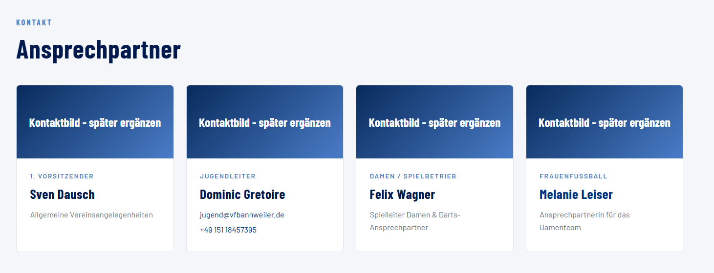

# Beschlossen

- Themen der Jugendabteilung immer direkt mit Dominic Gretoire klären
- Bereiche die noch nicht sicher sind oder Dinge fehlen, werden unsichtbar gemacht und nicht gezeigt.

# Fragen & Anliegen

## Mannschaften

### Herren Ü32 & Ü40
> Sichtbarkeit:  
> Der Bereich wird momentan nicht angezeigt!
- Kevin Frank
- Kontaktmöglichkeiten?
- Mannschaftsbild fehlt
- Kleiner Text dazu?

### Altherren
> Sichtbarkeit:  
> Der Bereich wird momentan nicht angezeigt!
- Mannschaftsbild fehlt noch
- Hans-Jürgen Deschler nachfragen

## Steeldart
- Felix fehlt Bild & Kontaktmöglichkeit
- Wünsche, was noch hinzugefügt werden soll?

## Jugend
- Trainer/Ansprechpartner
    - Dominic Gretoire - Jugendleiter: Bild + Kontaktdaten okay? 
    - Bilder der Jugendtrainer mit Vorstellung dazu? Vorerst ansonsten nur die Namen mit Funktion auflisten
        - Wer trainiert?
            - C-Jugend:
            - C-Jugend II:
            - D-Jugend:
            - D-Jugend II:
            - E-Jugend:
- Ansicht auch mit B-Jugend okay?:

## Verein
- Gruppenfoto Vorstand fehlt (Vorstandsmitglieder)
- Einzelfoto Meli + Sven fehlt (Vorstandsbild)

### Mitgliedsantrag
- 'Bei Fragen an Meli wenden' stimmt noch oder ist jemand anderes dafür zuständig?
- Fehlt beim folgenden Block was?
- 

### Sponsoring
- Ansprechpartner ist noch René?

### Kontakt
- Bei allen eine Kontaktmöglichkeit hinterlegen?
- 

### Impressum folgende Angaben prüfen:
- Wer prüft das Impressum? Rechtlich gesehen.

### DSGVO prüfen?
- René fragen oder wer ist sonst Beauftragter?

## Vorschläge
- Neuigkeiten: Hauptsächlich maximal 3 Kacheln mit aktuellesten Dingen